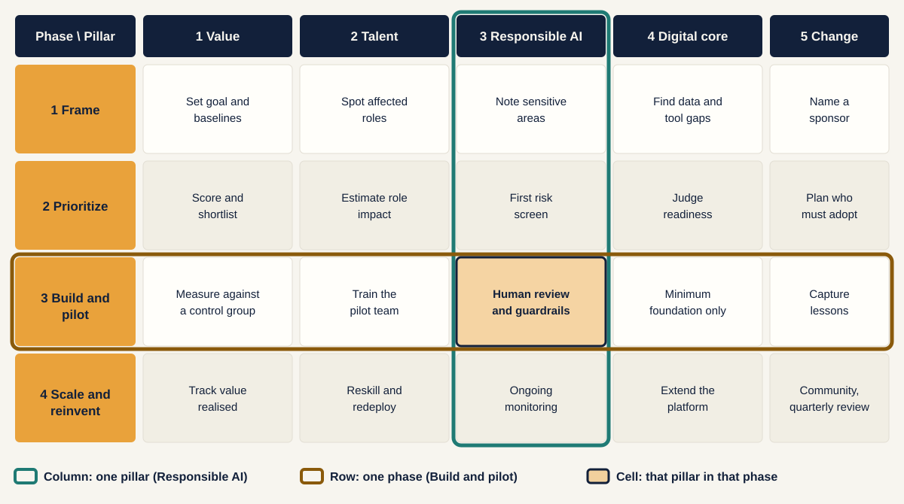

[Home](index.md) / [The big idea](idea.md) / Pillars and phases

# Pillars and phases: two axes, one grid

The framework answers two different questions. Keep them apart, then read them together.

---

## The confusion, cleared

| | **Pillars** | **Phases** |
|---|---|---|
| **The question** | What do we need to get right? | When do we do what? |
| **Count** | 5 | 4 |
| **Order** | No order. All five run side by side. | Strict order, one after another. |
| **How it ends** | Never "done". Each is kept up. | At a gate: go, fix or stop. |
| **If you skip one** | The programme gets stuck later. | The programme scales too early. |
| **Think of it as** | Workstreams | Stages of a journey |

> **Pillars are the workstreams. Phases are the calendar. Every phase needs every workstream.**

---

## The grid

Pillars run across the top. Phases run down the side. Each cell says what that pillar does in that phase.

*The cells shown are for a marketing programme.*

---

## How to read it

**Read down a column to follow one pillar through time.** Take Responsible AI, the highlighted column:

| Phase | What happens | In a marketing programme |
|---|---|---|
| **1. Frame** | Note sensitive areas | List where marketing uses personal data, price or fare claims, and brand voice |
| **2. Prioritize** | First risk screen | Rate each shortlisted use case for consent, brand and claim-accuracy risk |
| **3. Build and pilot** | Human review and guardrails | A person approves every message before it goes out, using an approved-claims library |
| **4. Scale and reinvent** | Ongoing monitoring | Sample live output, count incidents, and update the claims library |

The pillar starts as a note, becomes a screen, then a live control, then a routine.

**Read across a row to see everything happening at one moment.** Take Build and pilot, the highlighted row: you measure against a control group (Value), train the pilot team (Talent), review every output (Responsible AI), build only the minimum foundation (Digital core), and capture lessons (Change). All five happen together, on a small scope.

---

## Cell by cell: a marketing programme

The examples below suit both a fashion retailer and a regional airline. They are illustrative.

### Phase 1: Frame (weeks 0 to 4)

*Align on ambition and where value sits.* **Gate: leaders agree where to play.**

| Pillar | What happens | In a marketing programme |
|---|---|---|
| **1. Value** | Set the goal and baselines | Goal: cut content cost and lift repeat purchase (retail) or loyalty engagement (travel). Record today's cost per asset, campaign cycle time and conversion. |
| **2. Talent** | Spot affected roles | List who touches content and campaigns: copywriters, designers, CRM and campaign managers, agencies. |
| **3. Responsible AI** | Note sensitive areas | Personal data in targeting, claims about prices or fares, brand voice, consent. |
| **4. Digital core** | Find data and tool gaps | Is there one customer or traveller profile? Is the catalogue or destination content clean? Which email, ad, app and CRM tools must connect? |
| **5. Change** | Name a sponsor | The CMO as sponsor, with Finance agreeing the baseline. |

### Phase 2: Prioritize (weeks 4 to 8)

*Score the ideas and pick the right bets.* **Gate: business case clears the hurdle.**

| Pillar | What happens | In a marketing programme |
|---|---|---|
| **1. Value** | Score and shortlist | Score a long list on value and readiness. Shortlist three to five. Pick the pilot, such as product descriptions or destination content. |
| **2. Talent** | Estimate role impact | Estimate hours freed per role and which tasks shift from writing to reviewing and curating. |
| **3. Responsible AI** | First risk screen | Rate each shortlisted use case for consent, brand and claim-accuracy risk. |
| **4. Digital core** | Judge readiness | Score data and platform readiness per use case. This is why next-best-offer lands in "long-term investment". |
| **5. Change** | Plan who must adopt | Identify the teams and agencies who will use the output. Plan training and communication. |

### Phase 3: Build and pilot (months 2 to 6)

*Prove it small, with humans in the loop.* **Gate: beats control, few risk incidents.**

| Pillar | What happens | In a marketing programme |
|---|---|---|
| **1. Value** | Measure against a control group | Compare AI-assisted work with the normal process on cost per asset, cycle time and conversion. |
| **2. Talent** | Train the pilot team | Teach prompting, review and brand-voice checking to the pilot group. |
| **3. Responsible AI** | Human review and guardrails | Every output is approved before publishing. Use an approved-claims library and consent checks. |
| **4. Digital core** | Minimum foundation only | Build only what the pilot needs: product catalogue, brand guide, approval workflow and one channel connection. |
| **5. Change** | Capture lessons | Log what reviewers reject and why. Share early wins. |

### Phase 4: Scale and reinvent (month 6 onward)

*Industrialise and keep improving.* **Gate: value tracked against the case.**

| Pillar | What happens | In a marketing programme |
|---|---|---|
| **1. Value** | Track value realised | Compare results with the original business case every quarter. |
| **2. Talent** | Reskill and redeploy | Move freed time to testing and strategy. Run formal training. |
| **3. Responsible AI** | Ongoing monitoring | Sample live output, track incidents, and update the claims library. |
| **4. Digital core** | Extend the platform | Add channels and categories. Unify customer data to unlock next-best-offer. |
| **5. Change** | Community and quarterly review | Keep a prompt library, run a community of practice, and refresh the portfolio each quarter. |

---

## Three common mistakes

| Mistake | What goes wrong | Fix |
|---|---|---|
| **Treating pillars as phases** ("We will do Responsible AI after the pilot") | Risks appear when changing course is costly | Start every pillar in Frame, even if only as a note |
| **Treating phases as one pillar** ("Frame is just strategy") | Roles, risks and data gaps are found too late | Fill all five cells in every phase |
| **Skipping the gate** | A weak pilot gets scaled and the business case falls apart | Agree the gate test in advance, and stop if it is not met |

---

## Try it on your own programme

1. Draw a blank grid: your phases down the side, the five pillars across the top.
2. Write one sentence in each of the 20 cells.
3. Any cell you cannot fill is a gap. Resolve it before you pass that phase's gate.

---

## Next

Now that the grid is clear, the next page goes deep on each pillar.

[← The big idea](idea.md) · [**The five pillars →**](pillars.md)

---

**About.** Created by [Your name]. An independent, simplified framework with original diagrams and illustrative examples. It contains no confidential material from any employer or client; the example companies and figures are fictional. Content is licensed under [CC BY 4.0](https://creativecommons.org/licenses/by/4.0/).
