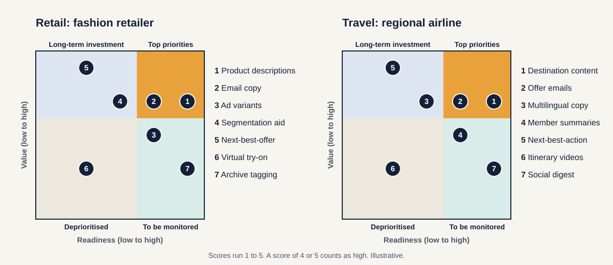
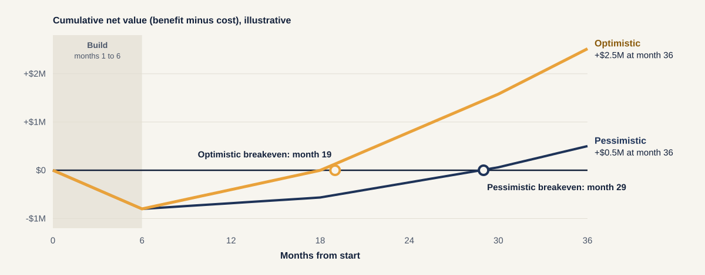
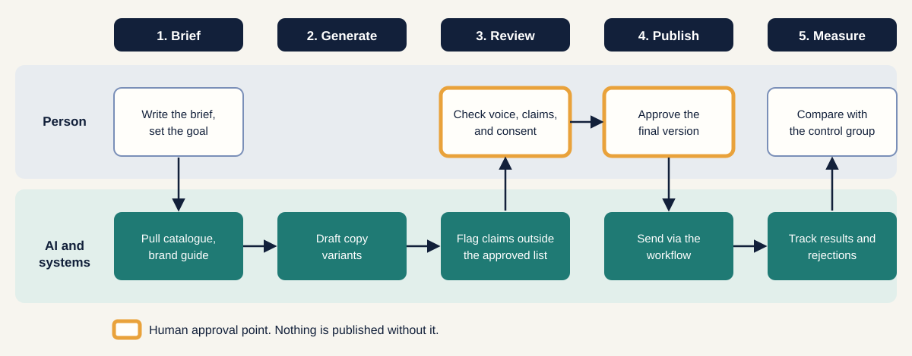

[Home](index.md) / [The four phases](phases.md) / Marketing example

# One programme, two industries: marketing

A complete walk-through of the framework, from Frame to Scale, for a fashion retailer and a regional airline.

> **Everything here is fictional.** The two organisations, every number and every result are invented to show how the method works. They are not real companies, benchmarks or forecasts. Replace them with your own data.

---

## The two organisations

| | **Retail: a fashion retailer** | **Travel: a regional airline** |
|---|---|---|
| **Business** | 180 stores, an app, a loyalty programme | 25 routes, a loyalty programme, several markets |
| **Marketing team** | Content, CRM and campaign teams plus two agencies | Content, CRM and loyalty teams plus two agencies |
| **The problem** | Content takes too long and costs too much, and campaigns feel generic | The same, plus campaigns must be adapted for each market |
| **Ambition** | More personalised campaigns at lower content cost | More engaged loyalty members at lower campaign cost |

---

## The programme at a glance

| Phase | Retail | Travel |
|---|---|---|
| **1. Frame** | Agree the ambition and record baselines | Agree the ambition and record baselines |
| **2. Prioritize** | Score seven ideas. Pilot a content engine for one category | Score seven ideas. Pilot destination content and offers for one market |
| **3. Build and pilot** | 12 weeks against a control group | 12 weeks against a control group |
| **4. Scale and reinvent** | Roll out in waves, then unlock next-best-offer | Roll out in waves, then unlock next-best-action |

---

## Phase 1: Frame

The CMO sponsors the programme. Finance agrees the numbers that will later be used to judge it.

**Baselines recorded before anything is built**

| Measure | Retail | Travel |
|---|---|---|
| **Cost to produce** | $20 per content asset | $9,000 per campaign |
| **Speed** | 6 days from brief to launch | 9 days from brief to launch |
| **Response** | 1.8% email-driven purchase rate | 1.4% offer conversion |
| **Loyalty** | 31% repeat purchase within 12 months | 38% of members active in the last 12 months |

**Sensitive areas noted:** personal data in targeting, claims about prices or fares, brand voice, consent.

**Gate 1 passed.** The ambition fits in one sentence, the baselines are agreed, and the sponsor has budget authority.

---

## Phase 2: Prioritize

Each team builds a long list and scores every idea from 1 to 5 on value and on readiness. A score of 4 or 5 counts as high.

**Retail scores**

| # | Use case | Value | Readiness | Placement |
|---|---|---|---|---|
| 1 | Product descriptions | 4 | 5 | **Top priority** |
| 2 | Email copy | 4 | 4 | **Top priority** |
| 3 | Ad variants | 3 | 4 | To be monitored |
| 4 | Segmentation aid | 4 | 3 | Long-term investment |
| 5 | Next-best-offer | 5 | 2 | Long-term investment |
| 6 | Virtual try-on | 2 | 2 | Deprioritised |
| 7 | Archive tagging | 2 | 5 | To be monitored |

**Travel scores**

| # | Use case | Value | Readiness | Placement |
|---|---|---|---|---|
| 1 | Destination content | 4 | 5 | **Top priority** |
| 2 | Offer emails | 4 | 4 | **Top priority** |
| 3 | Multilingual copy | 4 | 3 | Long-term investment |
| 4 | Member summaries | 3 | 4 | To be monitored |
| 5 | Next-best-action | 5 | 2 | Long-term investment |
| 6 | Itinerary videos | 2 | 2 | Deprioritised |
| 7 | Social digest | 2 | 5 | To be monitored |

**What the scores say.** The two top-priority ideas in each column share one build, so each organisation pilots them together: a **content engine** for one product category (retail) or one market (travel).

The biggest prize, next-best-offer or next-best-action, scores 5 on value but only 2 on readiness, because customer data lives in separate systems. It is not dropped. It waits until the foundation exists.

### The retail business case

**Inputs**

| Input | Value |
|---|---|
| Content assets produced per month | 15,000 |
| Cost per asset today | $20 |
| Email-driven revenue per year | $50M, at a 30% contribution margin |
| Build cost (months 1 to 6) | $0.8M |
| Run cost (from month 7) | $0.28M a year |
| Discount rate | 12% |

**Two scenarios**

| Assumption | Pessimistic | Optimistic |
|---|---|---|
| Cost saved per AI-assisted asset | 35% | 55% |
| Share of assets AI-assisted, in years 1, 2 and 3 after launch | 35%, 60%, 80% | 45%, 75%, 90% |
| Uplift in email-driven revenue at full effect | 1.0% | 2.5% |

The email uplift ramps to half its full effect in year 1, then reaches full effect.

**Results over 36 months**

| | Pessimistic | Optimistic |
|---|---|---|
| **Total cost** | $1.50M | $1.50M |
| **Total benefit** | $2.00M | $4.02M |
| **Net present value** | $0.25M | $1.87M |
| **Return on investment** (net benefit divided by cost) | 0.33x | 1.68x |
| **Breakeven** | Month 29 | Month 19 |
| **Annual value at steady state** (year 3 rate) | $1.16M | $2.16M |

**How each benefit is worked out**

- **Content cost saved** = assets per month × 12 × cost per asset × share AI-assisted × cost saved per asset. At steady state: $1.01M (pessimistic) or $1.78M (optimistic).
- **Email uplift** = email revenue × margin × uplift. At full effect: $0.15M (pessimistic) or $0.38M (optimistic).

**The agreed hurdle:** a positive NPV even in the pessimistic case, and payback within 30 months. The pessimistic case clears it with one month to spare, which is exactly what a team should know before it commits.

**Travel uses the same model with its own drivers:**

| Retail driver | Travel driver |
|---|---|
| Cost per content asset | Cost per campaign |
| Email-driven purchase uplift | Offer conversion uplift |
| Repeat purchase | Loyalty engagement and repeat bookings |

**Gate 2 passed.** Both business cases clear the hurdle, the risk screen finds no showstoppers, and the pilot scope and success measures are written down.

---

## Phase 3: Build and pilot

Twelve weeks. One product category (retail) or one market (travel), and one channel: email.

### The workflow

A person approves every output twice, at review and again at publish. Nothing goes out on the AI's say-so.

### The minimum foundation

| Need | Retail | Travel |
|---|---|---|
| **Source content** | Clean product catalogue | Destination and route content library |
| **Voice and rules** | Machine-readable brand guide, approved-claims library | Brand guide, approved fares-and-policies library |
| **Controls** | Approval workflow, consent check | Approval workflow, consent check |
| **Channel** | One email platform connection | One email platform connection |

Nothing else is built. A single customer profile is not on this list, because the pilot does not need one.

### The control group

A comparable set of categories (retail) or routes (travel) keeps working the normal way for the same 12 weeks. At the end, the two are compared.

### Results (fictional)

| Measure | Retail | Travel |
|---|---|---|
| **Cost to produce** | 46% lower than control | 38% lower than control |
| **Speed** | 6 days down to 2 days | 9 days down to 4 days |
| **Response** | Purchase rate 4% higher than control | Offer conversion 3% higher than control |
| **Reviewer rejection rate** | 22% in weeks 1 and 2, down to 9% by weeks 11 and 12 | 25% in weeks 1 and 2, down to 11% by weeks 11 and 12 |
| **Risk incidents** | 2 minor, both caught at review: a wrong promotion end date and an off-brand phrase | 1 minor, caught at review: an out-of-date baggage allowance in a draft |

**The gate test, set in advance:** at least 30% lower cost to produce, no drop in response, and no serious incident.

**Gate 3 passed.** The pilot beat the control group on every agreed measure. The business case assumed cost savings of 35% to 55% and an uplift of 1% to 2.5%, which sit below what the pilot showed, so the assumptions look cautious.

---

## Phase 4: Scale and reinvent

| Wave | Retail | Travel |
|---|---|---|
| **Wave 1** (months 7 to 12) | Remaining categories, email | Remaining markets, email |
| **Wave 2** (months 13 to 18) | App messages and ad copy | App messages and ad copy |
| **Wave 3** (months 19 to 24) | In-store signage and shelf labels | Airport and onboard screens |
| **In parallel** | Build a single customer profile | Build a single traveller profile |
| **Then** | Run a new Frame and Prioritize cycle for next-best-offer | Run a new Frame and Prioritize cycle for next-best-action |

**What changes for people:** copywriters and designers move toward briefing, editing and guarding the brand voice. Freed time goes to testing and customer insight. A community of practice shares prompts, and reviewers meet monthly to discuss what they rejected and why.

**The recurring gate.** Every quarter the sponsor reviews value against the business case, adoption by team, incidents, and which idea enters the pipeline next. Weak ideas are retired.

---

## What this example shows

1. **Baselines come first.** Without them, nothing in the results could be proved.
2. **The biggest prize waited.** Next-best-offer and next-best-action score highest on value but lowest on readiness, so the foundation came first.
3. **The pessimistic case matters.** It cleared the hurdle by one month. That is a useful thing to know before committing.
4. **A control group made the result credible.** Without it, "46% lower" would only have been a feeling.
5. **People approved everything.** Human review was a design choice, not an afterthought.
6. **The scope was small, then it grew.** One category, one channel, 12 weeks, then waves.

---

## Try it in your industry

Answer these six questions for any function, not just marketing:

1. What is the ambition, in one sentence?
2. Which three to five numbers will prove it, and what are they today?
3. What are the seven ideas, and what are their value and readiness scores?
4. Which one or two can be piloted now, on a small scope, with a control group?
5. What must a person always approve?
6. What will you build next, and what does it wait for?

The [toolkit](toolkit.md) has templates for the scoring grid, the business case and the risk map.

---

## Next

[← The four phases](phases.md) · [**Toolkit →**](toolkit.md)

---

**About.** Created by [Your name]. An independent, simplified framework with original diagrams and illustrative examples. It contains no confidential material from any employer or client; the example companies and figures are fictional. Content is licensed under [CC BY 4.0](https://creativecommons.org/licenses/by/4.0/).
