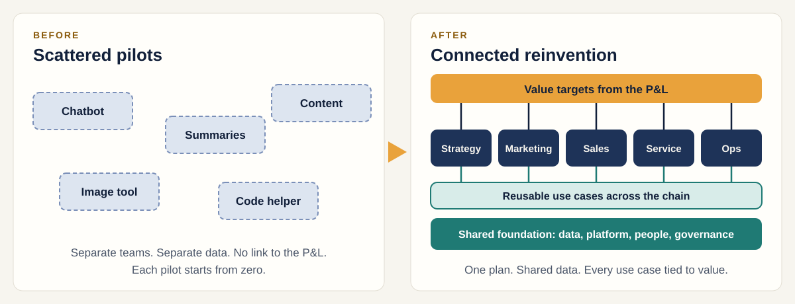

[Home](index.md) / The big idea

# From scattered pilots to connected reinvention

Gen AI pays off when it is planned as one programme tied to value, not run as a string of experiments.

---

## Why Gen AI pilots stall

Many organisations have a dozen impressive demos and no change in the numbers. Four causes keep showing up.

| Cause | What it looks like |
|---|---|
| **No line to value** | Nobody can say which P&L lever the pilot moves, so it never gets funded to scale. |
| **Weak foundation** | Data and platforms that work for a demo cannot carry a production workload. |
| **People and risk last** | Roles, controls and consent are raised at launch, when changing course is costly. |
| **Nothing is reusable** | Every pilot builds its own data pipeline and guardrails, so each one costs as much as the first. |

---

## One connected plan instead of five side projects

The same tools, organised around value targets and a shared foundation.

 

*Left: pilots that do not talk to each other. Right: every use case tied to a value target and built on shared parts.*

> **Reinvention means changing how the work gets done end to end, not adding a tool to the old process.**

---

## Three beliefs

Everything else in the framework follows from these.

1. **Value before technology.** Every use case must trace to a lever on the P&L: revenue, cost, risk or sustainability. If it does not, it waits.
2. **Readiness sets the order.** Ambition does not decide what goes first. What the data, platform, people and rules can support today does.
3. **People and risk from day one.** Roles, skills and controls are designed alongside the technology, not bolted on before launch.

---

## Table stakes and strategic bets

Not every use case is worth the same effort. Sort them first.

| | **Table stakes** | **Strategic bets** |
|---|---|---|
| **What it is** | Expected hygiene | Differentiating |
| **Why it matters** | Competitors will do it too. The aim is to do it efficiently and move on. | Harder and slower, with a bigger payoff. Needs a stronger data foundation first. |
| **Marketing example** | Generating product descriptions and email copy | Next-best-offer personalised to each customer |

---

## Value against readiness

Score each use case on both, then place it. Top right goes first.

| | **Low readiness** (not ready) | **High readiness** (ready now) |
|---|---|---|
| **High value** | **Long-term investment.** Build the foundation first. *Example: next-best-offer* | **Top priorities.** Pilot these. *Example: product descriptions* |
| **Low value** | **Deprioritised.** Revisit later. *Example: virtual try-on avatars* | **To be monitored.** Cheap to try, small prize. *Example: archive auto-tagging* |

*Placements are illustrative, for a retail marketing team. The next pages show how scores are built.*

---

## What changes in how you work

Six shifts that separate reinvention from experimentation.

| From | To |
|---|---|
| Use cases chosen by enthusiasm | Chosen by value and readiness |
| Isolated pilots | One portfolio with gates between phases |
| Tools bought first | Value targets and foundation first |
| Risk reviewed at launch | Risk designed in from the start |
| Fear of job loss | Freed capacity redeployed to higher-value work |
| Launch, then move on | Measure, learn and refresh each quarter |

---

## Next

The framework answers two questions: what to cover, and when. The next page puts them side by side.

[← Home](index.md) · [**Pillars and phases →**](axes.md)

---

**About.** Created by [Your name]. An independent, simplified framework with original diagrams and illustrative examples. It contains no confidential material from any employer or client; the example companies and figures are fictional. Content is licensed under [CC BY 4.0](https://creativecommons.org/licenses/by/4.0/).
