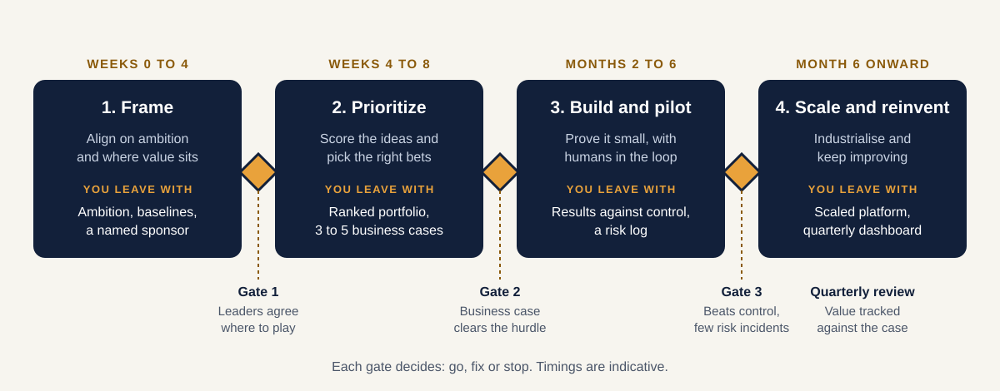
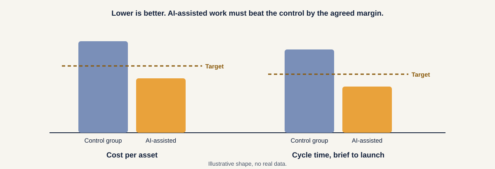
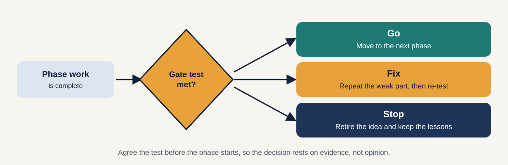

[Home](index.md) / [The five pillars](pillars.md) / The four phases

# The four phases

Four steps in order. Each one has a goal, a set of activities, something you leave with, and a gate that decides whether to go on.

| Phase | When | Goal | You leave with | Gate |
|---|---|---|---|---|
| **1. Frame** | Weeks 0 to 4 | Align on ambition and where value sits | Ambition, baselines, a named sponsor | Leaders agree where to play |
| **2. Prioritize** | Weeks 4 to 8 | Score the ideas and pick the right bets | Ranked portfolio, three to five business cases | Business case clears the hurdle |
| **3. Build and pilot** | Months 2 to 6 | Prove it small, with humans in the loop | Results against a control group, a risk log | Beats control, few risk incidents |
| **4. Scale and reinvent** | Month 6 onward | Industrialise and keep improving | A scaled platform, a quarterly dashboard | Value tracked against the case |

Timings are indicative. A small scope can move faster, and a large, regulated organisation may need longer. The order and the gates matter more than the dates.

The examples throughout come from a marketing programme and suit both a fashion retailer and a regional airline. They are illustrative.

---

## Phase 1: Frame

*Weeks 0 to 4. Align on ambition and where value sits.*

**What you do**

1. **State the ambition** in one sentence, for example: "More personalised campaigns at lower content cost."
2. **Map the value chain** and mark where Gen AI could matter most.
3. **Size the prize** at a high level for each function.
4. **Record baselines** for the numbers you want to move, so you can prove change later.
5. **Name an executive sponsor** and agree who owns the programme.
6. **Note the sensitive areas** and the data and tool gaps you already know about.

**You leave with:** an ambition statement, a value-chain heat map, baselines and a named sponsor.

**Marketing example**

| | Retail | Travel |
|---|---|---|
| **Ambition** | More personalised campaigns at lower content cost | More engaged loyalty members at lower campaign cost |
| **Baselines** | Cost per asset, campaign cycle time, email conversion, repeat purchase rate | Cost per campaign, cycle time, offer conversion, repeat bookings |
| **Sponsor** | CMO, with Finance agreeing the baselines | CMO or Head of Loyalty, with Finance agreeing the baselines |

**Gate 1: Leaders agree where to play.** Test it with these questions:

- [ ] Can the ambition be said in one sentence?
- [ ] Have we chosen which functions or value areas to start with?
- [ ] Are the baselines recorded and agreed by Finance?
- [ ] Is there a named sponsor with time and budget authority?

**Common mistake:** skipping baselines. Without them, no result can be proved later.

---

## Phase 2: Prioritize

*Weeks 4 to 8. Score the ideas and pick the right bets.*

**What you do**

1. **Build the long list** of use cases.
2. **Tag each one** as a table stake or a strategic bet.
3. **Score on value and readiness** and place each on the value-readiness grid. (See [Pillar 1](pillars.md#pillar-1-lead-with-value).)
4. **Shortlist three to five** and build a simple business case for each.
5. **Run a first risk screen** and estimate role impact for the shortlist.
6. **Choose the pilot:** high value, high readiness, small enough to finish.

**You leave with:** a ranked portfolio and three to five business cases, one of which is the pilot.

**Marketing example**

| | Retail | Travel |
|---|---|---|
| **Pilot chosen** | Product descriptions and email content for one category | Destination content and personalised offers for one market |
| **Held back** | Next-best-offer, until customer data is unified | Next-best-action, until traveller data is unified |
| **Why** | Content: high value, ready now. Next-best-offer: high value, not ready | Same logic |

**Gate 2: Business case clears the hurdle.** Test it with these questions:

- [ ] Does each shortlisted case have optimistic and pessimistic numbers?
- [ ] Does payback fall inside the limit we agreed?
- [ ] Have readiness gaps been costed, not just listed?
- [ ] Did the risk screen find any showstoppers?
- [ ] Is the pilot scope small, and are its success measures written down?

**Common mistake:** shortlisting ten ideas to keep everyone happy. Pick the few that can really be done, and park the rest on purpose.

---

## Phase 3: Build and pilot

*Months 2 to 6. Prove it small, with humans in the loop.*

**What you do**

1. **Build the minimum foundation** the pilot needs, no more.
2. **Design the human and AI workflow:** who does what, and who approves.
3. **Apply the controls** from the risk screen: human review, guardrails, consent checks.
4. **Train the pilot team.**
5. **Run the pilot against a control group**, a comparable group doing the work the normal way.
6. **Log risks, rejections and lessons** as you go.

**Why a control group matters:** without one, you cannot tell whether the result came from the AI or from something else, such as a seasonal change. A control group turns "it feels faster" into evidence.

**You leave with:** measured results against the control group, a risk log and a clear unit cost.

**Marketing example**

| | Retail | Travel |
|---|---|---|
| **Pilot scope** | One category, one channel such as email | One market, one channel such as email |
| **Human control** | A person approves every output before publishing | A person approves every output before publishing |
| **Measured** | Cost per asset, cycle time, click and conversion rates, reviewer rejection rate | Cost per campaign, cycle time, offer conversion, reviewer rejection rate |

**Gate 3: Beats control, few risk incidents.** Test it with these questions:

- [ ] Did AI-assisted work beat the control group by the agreed margin?
- [ ] Is the reviewer rejection rate falling?
- [ ] Were there any serious risk incidents, and were they handled?
- [ ] Do we know what it costs to run per asset or per campaign?
- [ ] Does the pilot team want to keep using it?

**Common mistake:** declaring victory from usage numbers. Usage says people tried it. Only the comparison says it worked.

---

## Phase 4: Scale and reinvent

*Month 6 onward. Industrialise and keep improving.*

**What you do**

1. **Extend the scope** to more categories, markets and channels, in waves.
2. **Reuse the parts** built in the pilot so each wave costs less.
3. **Run the workforce transition:** reskill, redeploy, and update role descriptions.
4. **Stand up a centre of excellence or community of practice.**
5. **Monitor risk and value** against the original case.
6. **Unlock the next bet** once the foundation supports it.

**You leave with:** a scaled platform, an operating model, an adoption and value dashboard, and a next-wave roadmap.

**Marketing example**

| | Retail | Travel |
|---|---|---|
| **Scale** | All categories, then app, ads and store signage | All markets, then app, ads and airport and onboard screens |
| **Next bet** | Next-best-offer, now that customer data is unified | Next-best-action, now that traveller data is unified |
| **Routine** | A quarterly review of the portfolio | A quarterly review of the portfolio |

**The recurring gate: value tracked against the case.** Review it every quarter:

- [ ] Is realised value on track with the business case?
- [ ] Is adoption growing, and where is it stalling?
- [ ] Are incidents rare and handled quickly?
- [ ] Which use case enters the pipeline next, and which should be retired?

**Common mistake:** treating scale as the finish. Scaling is where the loop in [Pillar 5](pillars.md#pillar-5-change-and-continuous-reinvention) starts.

---

## How gates work

A gate is a decision point at the end of a phase. It has three possible outcomes.

| Outcome | When | What happens |
|---|---|---|
| **Go** | The test is met | Move to the next phase |
| **Fix** | Close, but one part is weak | Repeat that part, then re-test |
| **Stop** | The case does not hold | Retire the idea, keep the lessons, and free the budget |

**Rules that keep gates honest**

1. **Write the test before the phase starts.** If the target moves afterwards, the gate means nothing.
2. **Decide with evidence,** such as baselines, control results and the risk log.
3. **Name who decides.** Usually the sponsor, with Finance and the risk owner in the room.
4. **Stopping is a good outcome.** A weak idea stopped early saves the cost of scaling it.

---

## Phases against pillars

Each phase has a job for every pillar. The [pillars and phases grid](axes.md) shows all twenty cells together.

---

## Next

You now have the model: five pillars, four phases and the gates between them. The next page walks through one complete example.

[← The five pillars](pillars.md) · [**Marketing example →**](example-marketing.md)

---

**About.** Created by [Your name]. An independent, simplified framework with original diagrams and illustrative examples. It contains no confidential material from any employer or client; the example companies and figures are fictional. Content is licensed under [CC BY 4.0](https://creativecommons.org/licenses/by/4.0/).
