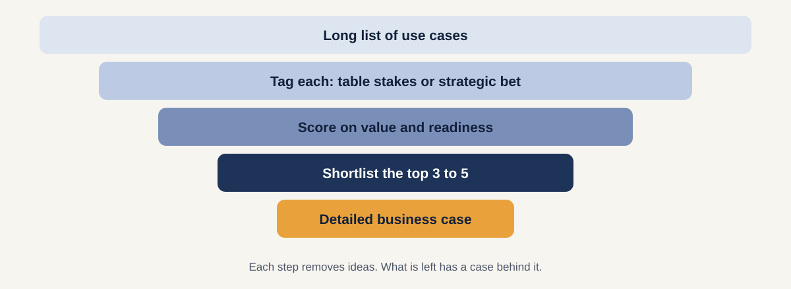
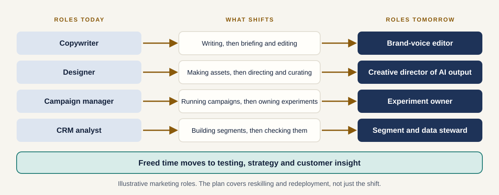
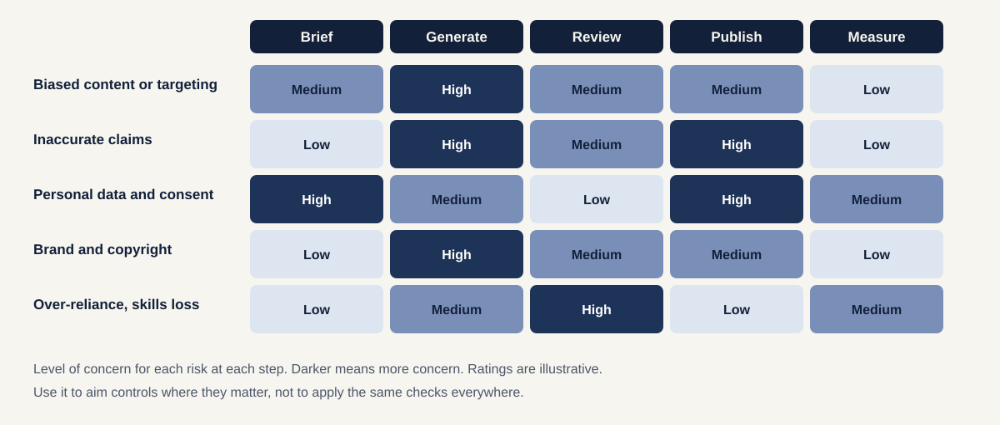
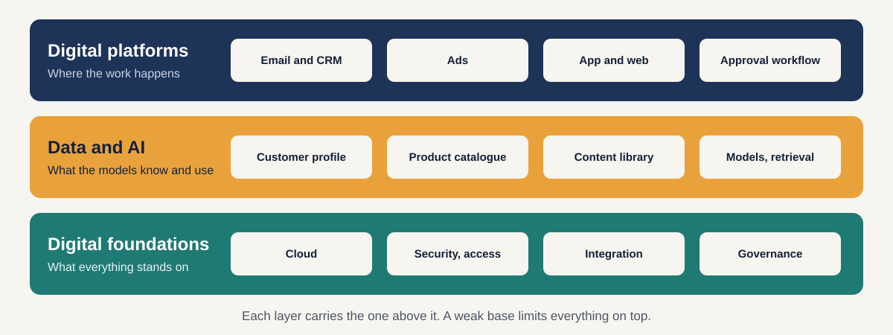
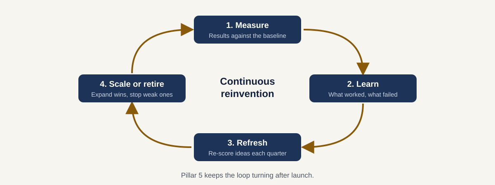

[Home](index.md) / [Pillars and phases](axes.md) / The five pillars

# The five pillars

Five areas that must all be covered. Each answers one question, has its own tools, and has one common way to go wrong.

| # | Pillar | The question | Jump to |
|---|---|---|---|
| 1 | **Lead with value** | Where is the money, and what comes first? | [Pillar 1](#pillar-1-lead-with-value) |
| 2 | **Talent and new ways of working** | How do roles and skills change? | [Pillar 2](#pillar-2-talent-and-new-ways-of-working) |
| 3 | **Responsible AI** | What can go wrong, and where? | [Pillar 3](#pillar-3-responsible-ai) |
| 4 | **Digital core** | What must be in place to run it at scale? | [Pillar 4](#pillar-4-digital-core) |
| 5 | **Change and continuous reinvention** | How does it stick and keep evolving? | [Pillar 5](#pillar-5-change-and-continuous-reinvention) |

The examples throughout come from a marketing programme and suit both a fashion retailer and a regional airline. They are illustrative.

---

## Pillar 1: Lead with value

> **Where is the money, and what comes first?**

Start from where the business makes or loses money, not from the technology. Every use case has to trace to a lever on the P&L.

**What you do**

1. **Size the value chain.** Estimate the impact by function (strategy, marketing, sales, service, operations) as a share of revenue, cost or profit.
2. **Build a long list** of use cases for each function.
3. **Tag each one** as a *table stake* (expected hygiene) or a *strategic bet* (differentiating).
4. **Score it** on value and readiness (below).
5. **Shortlist three to five** and build a business case for each.

**How scoring works**

| | Value: is it worth doing? | Readiness: can we do it now? |
|---|---|---|
| **Looks at** | Cost saved, revenue gained, risk reduced, sustainability | Technology, model quality, people, compliance |
| **Question** | How big is the prize? | Do the systems, output quality, skills and rules support it today? |

Placing each use case on value and readiness gives four outcomes:

| | **Low readiness** | **High readiness** |
|---|---|---|
| **High value** | **Long-term investment.** Build the foundation first. | **Top priorities.** Pilot these. |
| **Low value** | **Deprioritised.** Revisit later. | **To be monitored.** Cheap to try, small prize. |

**What a business case holds**

- Value drivers: revenue levers and cost levers, each with an optimistic and a pessimistic assumption
- Costs: build and set-up, then run
- Results: breakeven month, net present value (NPV) and return on investment (ROI), discounted at a rate you set

**Marketing example**

| | Retail | Travel |
|---|---|---|
| **Value levers** | Content cost, cycle time, conversion, repeat purchase | Campaign cost, cycle time, offer conversion, loyalty engagement |
| **Top priority** | Product descriptions and email content | Destination content and personalised offers |
| **Long-term investment** | Next-best-offer | Next-best-action |

**Common mistake:** choosing use cases by enthusiasm, or setting one fixed money hurdle for every client. Scale the hurdle to the size of the business, for example as a share of revenue.

**You leave with:** a ranked portfolio and three to five business cases.

---

## Pillar 2: Talent and new ways of working

> **How do roles and skills change?**

Gen AI changes the work, the workforce and the worker. The aim is to redeploy freed time to higher-value work, not simply to cut roles.

**What you do**

1. **Map roles today against roles tomorrow.** For each affected role, list which tasks shrink, which grow and which are new.
2. **Estimate freed capacity** for each role, in hours or as a share of time.
3. **Define new roles** that appear, such as a brand-voice editor.
4. **Plan the skills shift:** prompting, reviewing and editing output, and judging quality.
5. **Plan redeployment.** Say where the freed time goes and who moves where.

**Three views to keep in mind**

| View | The question |
|---|---|
| **Work** | Which tasks change, and by how much? |
| **Workforce** | How many roles and how much capacity are affected? |
| **Worker** | What skills does each person need, and how do they feel about it? |

**Marketing example:** copywriters move from writing every variant to briefing, editing and guarding the brand voice. Campaign managers move from running each campaign to owning experiments. The freed time goes to testing and customer insight.

**Common mistake:** presenting the programme as headcount reduction. People then resist it, and the best ones leave. Lead with redeployment and reskilling.

**You leave with:** a role impact map and a reskilling plan.

---

## Pillar 3: Responsible AI

> **What can go wrong, and where?**

Risk differs by step. Map it across the journey so controls go where they matter instead of being applied everywhere the same way.

**What you do**

1. **List the journey steps.** For marketing: brief, generate, review, publish, measure.
2. **List the risks** that apply to each step.
3. **Rate the level of concern** for each risk at each step.
4. **Set a control** for every high-concern cell.
5. **Monitor** once live.

**Risks to consider**

| Risk | In plain words |
|---|---|
| **Bias** | Content or targeting treats groups unfairly |
| **Liability** | The organisation is responsible for what the model says or does |
| **Unreliable output** | Confident but wrong answers |
| **Confidentiality and consent** | Personal or private data is used or leaked |
| **Sustainability** | The energy and resource cost of running the models |
| **Workforce transition** | The impact on people and skills |

**Marketing controls**

- A person approves every output before it is published
- An approved-claims library for prices, fares, offers and policies
- Consent checks on any personal data used for targeting
- Brand guardrails and a copyright check on generated images
- Regular sampling of live output

**Common mistake:** adding governance only at launch, or applying one heavy process to everything. Design it in from the Frame phase and aim it at the high-concern cells.

**You leave with:** a risk-by-journey map and a control for each high-concern risk.

---

## Pillar 4: Digital core

> **What must be in place to run it at scale?**

A demo can run on almost anything. Production cannot. The digital core is what lets pilots grow up.

**Three layers**

| Layer | What it is | Marketing examples |
|---|---|---|
| **Digital platforms** | The systems where work happens | Email and CRM, ads, app and web, approval workflow |
| **Data and AI** | The information and models the work uses | Customer profile, product catalogue, content library, models and retrieval |
| **Digital foundations** | What everything stands on | Cloud, security and access, integration, governance |

**What you do**

1. **Score each capability** as it is today and as it needs to be.
2. **Find the gaps** that block your shortlisted use cases.
3. **Build the minimum foundation** the pilot needs, no more.
4. **Build reusable parts**, such as data pipelines, retrieval and guardrails, so each later use case costs less.

**Marketing example:** the pilot needs a clean product catalogue (or destination library), a machine-readable brand guide, an approval workflow and one channel connection. Next-best-offer additionally needs a single customer profile, which is why it waits.

**Common mistake:** building a grand platform before proving value, or letting every pilot build its own. Build the minimum, make it reusable, and extend it each phase.

**You leave with:** a current-versus-target checklist and a minimum viable foundation.

---

## Pillar 5: Change and continuous reinvention

> **How does it stick and keep evolving?**

Launching is not the finish. Models, tools and customer behaviour keep moving, so the programme needs a way to learn and to refresh itself.

**What you do**

1. **Name an executive sponsor** and an owner.
2. **Track adoption and results,** not just usage. Measure the same numbers before and after.
3. **Set up a centre of excellence or community of practice** to share prompts, lessons and guardrails.
4. **Train in waves,** starting with the pilot team.
5. **Review the portfolio every quarter.** Re-score ideas, expand wins and retire what does not work.

**Marketing example:** a shared prompt library, a monthly session where reviewers explain what they rejected and why, and a quarterly review that decides which categories or markets to add next.

**Common mistake:** launching and moving on. Without a loop, early wins fade and the next wave of use cases never starts.

**You leave with:** an adoption dashboard and a quarterly review routine.

---

## How the pillars depend on each other

| Pillar | What it decides | It depends on |
|---|---|---|
| **1. Value** | What to do first | Readiness from pillars 3 and 4 |
| **2. Talent** | Who does what | The use cases chosen in pillar 1 |
| **3. Responsible AI** | How it is done safely | Where the use cases touch data, claims and customers |
| **4. Digital core** | Whether it can run at scale | The shortlist from pillar 1 |
| **5. Change** | Whether it lasts | Results from every other pillar |

The pillars are not a sequence. They run side by side and shape each other, which is why the [grid of pillars and phases](axes.md) matters.

---

## Next

The pillars say what to cover. The phases say when.

[← Pillars and phases](axes.md) · [**The four phases →**](phases.md)

---

**About.** Created by [Your name]. An independent, simplified framework with original diagrams and illustrative examples. It contains no confidential material from any employer or client; the example companies and figures are fictional. Content is licensed under [CC BY 4.0](https://creativecommons.org/licenses/by/4.0/).
