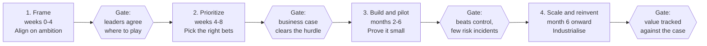

# Gen AI Reinvention Framework

**A plain-language guide to adopting generative AI in any industry: five pillars to cover, four phases to follow, and one running example (marketing) shown in retail and travel.**

> Most Gen AI efforts stall as a pile of disconnected pilots. This framework treats Gen AI as a **reinvention agenda**: start from value, sequence by readiness, and design people, risk and platform in from day one.

  <svg xmlns="http://www.w3.org/2000/svg" viewBox="0 0 1200 440" width="1200" height="440" role="img" aria-label="Five pillars of Gen AI reinvention standing on a base of four phases">
  <rect width="1200" height="440" fill="#12203A"/>
  <text x="600" y="62" text-anchor="middle" font-family="Arial, Helvetica, sans-serif" font-size="38" font-weight="700" fill="#F7F5EF">Gen AI Reinvention Framework</text>
  <text x="600" y="98" text-anchor="middle" font-family="Arial, Helvetica, sans-serif" font-size="20" fill="#C9D3E3">Five pillars say what to cover. Four phases say when.</text>
  <polygon points="80,140 600,116 1120,140" fill="#E9A23B"/>
  <g font-family="Arial, Helvetica, sans-serif" text-anchor="middle">
    <g>
      <rect x="110" y="150" width="180" height="170" rx="10" fill="#1E3358"/>
      <text x="200" y="196" font-size="44" font-weight="700" fill="#E9A23B">1</text>
      <text x="200" y="236" font-size="21" font-weight="700" fill="#F7F5EF">Lead with</text>
      <text x="200" y="262" font-size="21" font-weight="700" fill="#F7F5EF">value</text>
      <text x="200" y="298" font-size="15" fill="#C9D3E3">Where is the money?</text>
    </g>
    <g>
      <rect x="310" y="150" width="180" height="170" rx="10" fill="#1E3358"/>
      <text x="400" y="196" font-size="44" font-weight="700" fill="#E9A23B">2</text>
      <text x="400" y="236" font-size="21" font-weight="700" fill="#F7F5EF">Talent and</text>
      <text x="400" y="262" font-size="21" font-weight="700" fill="#F7F5EF">new work</text>
      <text x="400" y="298" font-size="15" fill="#C9D3E3">Who does what?</text>
    </g>
    <g>
      <rect x="510" y="150" width="180" height="170" rx="10" fill="#1E3358"/>
      <text x="600" y="196" font-size="44" font-weight="700" fill="#E9A23B">3</text>
      <text x="600" y="236" font-size="21" font-weight="700" fill="#F7F5EF">Responsible</text>
      <text x="600" y="262" font-size="21" font-weight="700" fill="#F7F5EF">AI</text>
      <text x="600" y="298" font-size="15" fill="#C9D3E3">What can go wrong?</text>
    </g>
    <g>
      <rect x="710" y="150" width="180" height="170" rx="10" fill="#1E3358"/>
      <text x="800" y="196" font-size="44" font-weight="700" fill="#E9A23B">4</text>
      <text x="800" y="236" font-size="21" font-weight="700" fill="#F7F5EF">Digital</text>
      <text x="800" y="262" font-size="21" font-weight="700" fill="#F7F5EF">core</text>
      <text x="800" y="298" font-size="15" fill="#C9D3E3">What must exist?</text>
    </g>
    <g>
      <rect x="910" y="150" width="180" height="170" rx="10" fill="#1E3358"/>
      <text x="1000" y="196" font-size="44" font-weight="700" fill="#E9A23B">5</text>
      <text x="1000" y="236" font-size="21" font-weight="700" fill="#F7F5EF">Change and</text>
      <text x="1000" y="262" font-size="21" font-weight="700" fill="#F7F5EF">reinvention</text>
      <text x="1000" y="298" font-size="15" fill="#C9D3E3">How does it stick?</text>
    </g>
  </g>
  <rect x="110" y="338" width="980" height="62" rx="10" fill="#1F7A74"/>
  <g font-family="Arial, Helvetica, sans-serif" font-size="19" font-weight="700" fill="#F7F5EF" text-anchor="middle">
    <text x="233" y="375">1 Frame</text>
    <text x="478" y="375">2 Prioritize</text>
    <text x="723" y="375">3 Build and pilot</text>
    <text x="968" y="375">4 Scale and reinvent</text>
  </g>
  <g stroke="#F7F5EF" stroke-width="2" opacity="0.6">
    <line x1="355" y1="350" x2="355" y2="388"/>
    <line x1="600" y1="350" x2="600" y2="388"/>
    <line x1="845" y1="350" x2="845" y2="388"/>
  </g>
  <text x="600" y="426" text-anchor="middle" font-family="Arial, Helvetica, sans-serif" font-size="15" fill="#8FA0BF">Pillars: what to cover  ·  Phases: when to do it, with a gate between each</text>
</svg>

---

## Why this exists

Teams usually ask two different questions at once, and that is where the confusion starts:

| Question | Answer | Axis |
|---|---|---|
| **What** do we need to get right? | Five pillars | Coverage |
| **When** do we do what? | Four phases | Sequence |

Read the framework as a grid. Every phase touches every pillar, with a different job in each cell.

  

*Read across a row to see one phase. Read down a column to see one pillar. The cells shown are for a marketing programme.*

---

## The five pillars (what to cover)

| # | Pillar | The question it answers |
|---|---|---|
| 1 | **Lead with value** | Where is the money, and what do we do first? |
| 2 | **Talent and new ways of working** | How do roles and skills change? |
| 3 | **Responsible AI** | What can go wrong, and where? |
| 4 | **Digital core** | What must be in place to run this at scale? |
| 5 | **Change and continuous reinvention** | How does it stick and keep evolving? |

## The four phases (when to do it)

*Timings are indicative. No gate passed, no scale-up.*

---

## One example, two industries: marketing

The same stream, applied to a fashion retailer and a regional airline. The structure is identical; only the levers, risks and data change.

| | **Retail (fashion retailer)** | **Travel (regional airline)** |
|---|---|---|
| **Goal** | Cut content cost, lift repeat purchase | Cut campaign cost, lift loyalty engagement |
| **First pilot** | Product descriptions and email content | Destination content and personalised offers |
| **Bigger bet, later** | Next-best-offer, once customer data is unified | Next-best-action, once traveller data is unified |
| **Key risks** | Off-brand output, false price or promo claims, consent | Wrong fares or policies, cultural missteps, consent |
| **Pilot scope** | One category, one channel, human review | One market, one channel, human review |
| **Measured against** | A control group | A control group |

> The retailer and airline are **illustrative scenarios**, not real client cases.

---

## What you will find here

| Section | What it gives you |
|---|---|
| [`docs/`](docs/) | The full guide as a website, with diagrams for every pillar and phase |
| [`templates/`](templates/) | Reusable tools: use-case scoring grid, business case model, risk-by-journey map, role impact map |
| [`assets/`](assets/) | Diagrams used across the guide (SVG, free to reuse with credit) |

> Planned. Folders are added as each page is published.

## Who this is for

- **Business leaders** deciding where Gen AI will actually pay back
- **Strategy and transformation teams** building a roadmap and business case
- **Marketing, product and operations leads** running a first pilot
- **Anyone** who wants the framework explained without jargon

## Start here

1. Read **The big idea** and **Two axes: pillars and phases** to get the model.
2. Walk through the **marketing example** for your industry.
3. Use the **templates** on your own use cases.

---

## About

Created by **[Your name]**. This is an independent, simplified framework with original diagrams and illustrative examples. It does not contain confidential material from any employer or client, and the example figures and companies are fictional.

Questions, corrections and industry examples are welcome: open an issue or a pull request.

## Licence

Content is licensed under [CC BY 4.0](LICENSE): share and adapt with credit.
